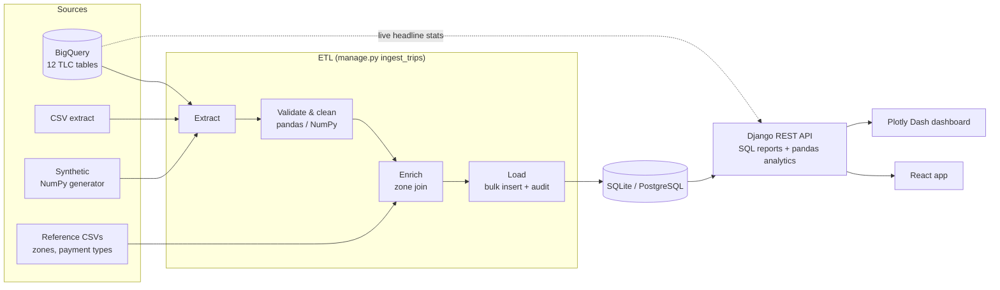

# NYC Taxi Revenue & Operations Analytics

**Live demo: https://isingh7.github.io/taxi-project/**. The demo is the React app reading a static snapshot of the API, built by GitHub Actions from synthetic sample data (see [`deploy-pages.yml`](.github/workflows/deploy-pages.yml)). The Dash tab shows a preview there, because Dash needs a Python server.

A full-stack data application for New York TLC taxi data. A Python ETL pipeline
pulls trips from **Google BigQuery** (or CSV, or a synthetic generator),
validates them with **pandas/NumPy** data-quality rules, joins reference data
and loads a **relational store** (SQLite locally, PostgreSQL on AWS). A
**Django REST API** serves the analytics to a **React** front end and a
**Plotly Dash** dashboard. Both run as containers on **AWS ECS**.



## Quick start (no cloud credentials needed)

```bash
pip install -r requirements-dev.txt
python manage.py migrate
python manage.py ingest_trips --all --rows 15000   # synthetic data for all 12 tables
python manage.py runserver                          # API      -> http://localhost:8000/api/
python -m dashboard.app                             # Dash     -> http://localhost:8050

cd taxi_frontend
cp .env.example .env.local                          # add your Google Maps key
npm install && npm start                            # React    -> http://localhost:3000
```

To use live BigQuery, set `GOOGLE_APPLICATION_CREDENTIALS` to a service-account
JSON file. Then load real data with `ingest_trips --source bigquery`.
Or run the whole stack with Postgres: `docker compose up --build`, then
`docker compose run --rm etl`.

## What's in the project

| Area | What was built | Where |
|---|---|---|
| **Python, pandas, NumPy** | Vectorised data-quality engine; robust (median/MAD) outlier detection; NumPy zone matching (no row loops); revenue time series with returns, rolling volatility, drawdown and anomaly flags; synthetic data generator | [`services/quality.py`](taxi_api/services/quality.py), [`analytics.py`](taxi_api/services/analytics.py), [`enrichment.py`](taxi_api/services/enrichment.py), [`sources.py`](taxi_api/services/sources.py) |
| **SQL and relational data** | Star-schema models (fact `Trip`, dimensions `Zone` and `PaymentType`, audit `IngestionRun`); hand-written SQL with joins, CTEs and window functions (`RANK`, `ROW_NUMBER`, `SUM() OVER`); parameterised queries; portable SQLite ↔ Postgres; BigQuery cost cut from 9 to 4 scans | [`models.py`](taxi_api/models.py), [`sql_reports.py`](taxi_api/services/sql_reports.py), [`bigquery_live.py`](taxi_api/services/bigquery_live.py) |
| **Integrating multiple sources** | BigQuery + CSV + synthetic behind one extract interface; reference-data joins; payment codes from different source systems harmonised (`CSH`/`CRD`/`1`/`1.0`) | [`sources.py`](taxi_api/services/sources.py), [`constants.py`](taxi_api/constants.py) |
| **Back end** | Django REST API: headline stats with BigQuery → local fallback, analytics, data-quality and audit endpoints, CSV export; env-driven settings; caching | [`views.py`](taxi_api/views.py), [`settings.py`](taxi_project/settings.py) |
| **Front end** | React + Material UI analytics app: sidebar navigation across five linkable views (Overview, Revenue, Demand & locations, Data quality, and the Dash dashboard embedded in the page), KPI cards, Chart.js charts, styled map, responsive down to phone width, plain-English errors, CSV export | [`taxi_frontend/src`](taxi_frontend/src) |
| **Dashboard design** | Plotly Dash: KPI tiles, daily revenue with 7-day average and anomaly markers, drawdown, hourly demand, fare distribution, ranked borough/payment bars, sortable DQ report. Colour-blind-safe palette, one y-axis per chart | [`dashboard/`](dashboard) |
| **Testable, high-quality code** | 75 pytest tests (90% coverage) + 12 Jest tests; ruff lint; CI runs the suite on **both** SQLite and Postgres | [`taxi_api/tests`](taxi_api/tests), [`.github/workflows/ci.yml`](.github/workflows/ci.yml) |
| **Data quality and ownership** | 12 documented rules (reject / fix / flag); every load audited with row counts and reasons; totals reconcile | [`docs/DATA_DICTIONARY.md`](docs/DATA_DICTIONARY.md) |
| **Working with business users** | Requirements log with acceptance criteria, **challenged requirements** (min/max vs percentiles, cash tips, "just delete bad rows") and open questions | [`docs/REQUIREMENTS.md`](docs/REQUIREMENTS.md) |
| **Financial analytics** | Revenue treated as a P&L series: daily returns, volatility, drawdown, 3σ anomaly alerts; revenue shown with and without flagged trips | [`analytics.py`](taxi_api/services/analytics.py) |
| **AWS ECS** | Dockerfiles, docker-compose, Fargate task definitions (API, dashboard, scheduled ETL), Secrets Manager, OIDC deploy workflow, runbook | [`infra/ecs`](infra/ecs), [`docs/AWS_DEPLOYMENT.md`](docs/AWS_DEPLOYMENT.md) |

## Fixes to the original version

| Problem | Fix |
|---|---|
| **SQL injection.** The URL table name went straight into the BigQuery SQL | Whitelist in `constants.ALLOWED_TABLES`; unknown tables return 404; tests try injection strings |
| Credentials path and Django secret key hard-coded in `settings.py` | Read from environment variables; settings refuse to start in production without a secret |
| App crashed on start without GCP credentials (client created at import) | Lazy client; local-store fallback |
| 9 full-table BigQuery scans per page view | 4 queries (conditional aggregation) + 24 h cache |
| `toFixed` on a null tip crashed the React page; errors only went to the console | Null-safe formatting; user-facing error messages with the fix to run |
| Marketing-style page (banner, chart-type picker that drew min/avg/max as pie and radar charts) | Professional analytics UI built with Material UI; chart types chosen for the data (lines for time, ranked bars instead of pies) |
| `class` instead of `className`; `<p>` inside `<p>` | Fixed |
| No tests | 87 automated tests |

Writing the tests also found three bugs in the new analytics code before it
shipped. The anomaly detector included the anomalous day in its own baseline.
A rolling window could have fewer periods than its minimum. And `row.pct_change`
inside `iterrows` returned the pandas *method* instead of the column.

## API

| Endpoint | Description |
|---|---|
| `GET /api/health/` | Liveness and row count |
| `GET /api/tables/` | 12 TLC tables and whether each is loaded |
| `GET /api/data/<table>/?source=auto\|bigquery\|local` | Headline stats (v1 contract + `data_source`) |
| `GET /api/analytics/<table>/` | KPIs, hourly, daily risk series, payment mix, borough league table, top routes, fare histogram |
| `GET /api/analytics/<table>/daily.csv` | Daily revenue series for Excel |
| `GET /api/data-quality/<table>/` | Latest ingestion run with its full DQ report |
| `GET /api/ingestion-runs/` | Audit log of the last 50 loads |

## Tests

```bash
pytest --cov                                    # backend + dashboard
ruff check .
cd taxi_frontend && CI=true npm test -- --watchAll=false
```
