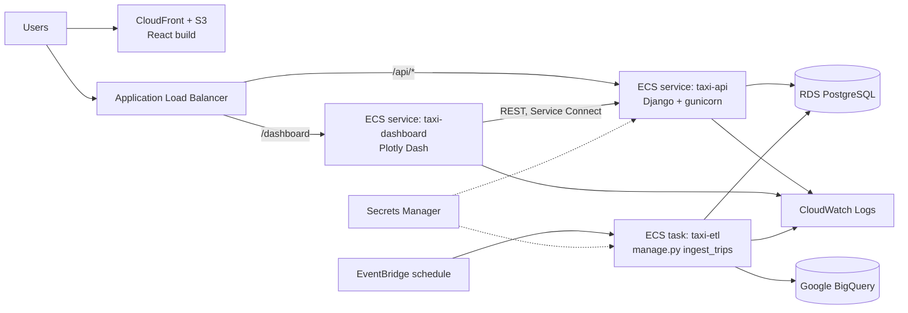

# Deploying to AWS ECS (Fargate)



## Components

| Piece | Definition | Notes |
|---|---|---|
| API service | `infra/ecs/task-definition-api.json` | 0.5 vCPU / 1 GB; runs migrations on start; health check `/api/health/` |
| Dashboard service | `infra/ecs/task-definition-dashboard.json` | Stateless; only needs `API_BASE_URL`, no database credentials |
| ETL task | `infra/ecs/task-definition-etl.json` | Not a service; run on a schedule by EventBridge (e.g. nightly) |
| Secrets | AWS Secrets Manager | Django key, RDS credentials, GCP service-account JSON; nothing secret in images or env files |
| Logs | CloudWatch `/ecs/taxi-*` | Django logs to stdout (see `LOGGING` in settings) |

## One-time setup

1. Create ECR repositories `taxi-api` and `taxi-dashboard`.
2. Create an RDS PostgreSQL instance in private subnets. Store its credentials in
   Secrets Manager as `taxi/rds`.
3. Create the secrets `taxi/django-secret-key` and `taxi/gcp-service-account`.
4. Create the IAM roles:
   * `taxiEcsTaskExecutionRole`: `AmazonECSTaskExecutionRolePolicy`, plus
     `secretsmanager:GetSecretValue` on `taxi/*`
   * a GitHub OIDC deploy role for `.github/workflows/deploy-ecs.yml`
5. Create the ECS cluster and the two services (Fargate, private subnets, behind the ALB).
   Use ECS Service Connect so the dashboard reaches the API at `api.taxi.local`.
6. Add an EventBridge Scheduler rule that runs the `taxi-etl` task definition nightly.

## Deploying

Run **Actions → Deploy to ECS** in GitHub. The workflow:

1. assumes the deploy role through OIDC (no stored AWS keys),
2. builds and pushes each image tagged with the commit SHA,
3. renders the task definition with the new image,
4. updates the ECS service and waits for it to stabilise. ECS rolls back if
   the new tasks fail their health checks.

## Running the ETL by hand

```bash
aws ecs run-task --cluster taxi --launch-type FARGATE \
  --task-definition taxi-etl \
  --network-configuration "awsvpcConfiguration={subnets=[subnet-...],securityGroups=[sg-...]}"
```

Watch it in CloudWatch (`/ecs/taxi-etl`). Each run also appears at
`/api/ingestion-runs/` with its row counts and data-quality report.

## Troubleshooting

| Symptom | Check |
|---|---|
| Service keeps restarting | CloudWatch logs; usually a missing `DJANGO_SECRET_KEY` (settings refuse to start without one when `DEBUG=false`) |
| `400 Bad Request` from the API | `DJANGO_ALLOWED_HOSTS` must include the ALB / domain host name |
| Dashboard shows "API unavailable" | Service Connect name and `API_BASE_URL`; API security group must allow the dashboard SG on 8000 |
| ETL fails with `DefaultCredentialsError` | The `taxi/gcp-service-account` secret is missing or malformed |
| `/api/data/...` returns `"data_source": "local"` | Expected when `BIGQUERY_ENABLED=false`; the API is serving from RDS |
