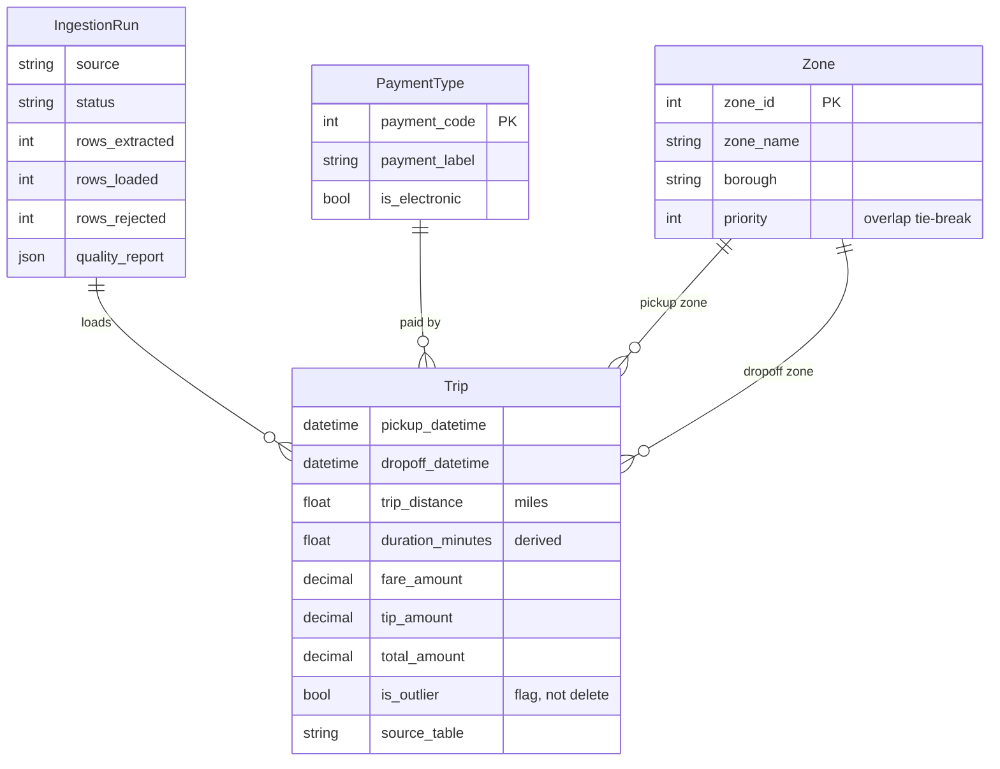

# Data dictionary and quality rules

## Sources

| Source | Kind | Used for |
|---|---|---|
| `bigquery-public-data.new_york.tlc_*_trips_*` | Google BigQuery (12 tables, 2009-2016) | Live headline stats; ETL extract |
| `taxi_api/reference_data/zones.csv` | CSV reference data | Pickup/dropoff zone and borough |
| `taxi_api/reference_data/payment_types.csv` | CSV reference data | Payment labels, electronic flag |
| `SyntheticSource` | NumPy generator | Reproducible demo and test data with realistic defects |
| `CsvSource` | Any CSV with the canonical columns | Ad-hoc extracts from business users |

## Schema (`taxi_api` app)

Money is stored as `DECIMAL(10,2)`, not float, so sums reconcile to the cent.

## Quality rules

Applied in order by `services/quality.py`. All thresholds live in `constants.py`.

| Rule | Action | Logic |
|---|---|---|
| `duplicate_rows` | fix | Exact duplicates removed |
| `payment_code_unmapped` | fix | Codes not in the alias map become `5 Unknown` |
| `passenger_count_zero` | fix | `<= 0` set to null |
| `pickup_outside_nyc` / `dropoff_outside_nyc` | fix | Coordinates outside the NYC bounding box set to null; trip kept |
| `missing_timestamp` | reject | Pickup or dropoff missing or unparseable |
| `dropoff_before_pickup` | reject | Duration `<= 0` |
| `duration_out_of_range` | reject | Under 60 s or over 4 h |
| `distance_out_of_range` | reject | `<= 0` or `> 100` miles |
| `fare_out_of_range` | reject | Below the $2.50 flag-drop or above $1,000 |
| `total_less_than_fare` | reject | Components don't reconcile |
| `implausible_speed` | reject | Average speed > 80 mph |
| `fare_per_mile_outlier` | flag | Robust z-score of log(fare/mile) > 3.5 (median/MAD, so the outliers can't hide by inflating the std dev) |

Each rejected row keeps the **first** rule it failed as `reject_reason`. The
report stores per-rule counts, % of input, column completeness and pass rate.
You can see it at `/api/data-quality/<table>/`, in the dashboard and in Django admin.

## Derived measures

| Field | Definition |
|---|---|
| `duration_minutes` | `(dropoff - pickup)` in minutes |
| `speed_mph` | `trip_distance / hours` |
| `fare_per_mile` | `fare_amount / trip_distance` |
| `tip_pct` | `tip_amount / fare_amount`; meaningful for card payments only |
| `rolling_mean` | Trailing 7-day mean of daily revenue |
| `pct_change` | Day-over-day revenue return |
| `volatility` | Trailing 7-day std dev of daily returns |
| `drawdown_pct` | % below the running peak of the full-window 7-day mean |
| `is_anomaly` | Day's revenue more than 3σ from the previous 7 days |
